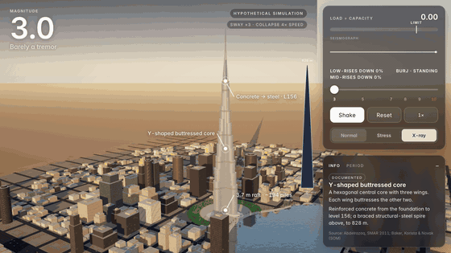

# Burj Quake

**An interactive 3D simulation of how the world's tallest building responds to earthquakes from M3 to M10.**



<sub>26 s screencast recorded in the app ([MP4](docs/media/screencast.mp4)). X-ray anatomy, then M7 (low-rises fail first), then M10 in the stress view: the spire joint hits the limit, then the base, and the tower crushes down into its own rubble.</sub>

Pick a magnitude and press **Shake**. You can then orbit around Downtown Dubai and switch between three views:

- **Normal:** the city and the tower at golden hour.
- **Stress:** a heat map of load ÷ capacity on the tower. Red means past the limit.
- **X-ray:** the structural anatomy. It shows the Y-shaped buttressed core, the reinforced concrete up to level 156, the steel spire above it, and the 3.7 m raft on piles.

The simulation runs in real time in the browser on WebGL 2 (three.js). It needs no build step, no server code and no dependencies to install.

> ⚠️ **Hypothetical simulation.** This is an educational visualisation, not an engineering analysis. Magnitude is not site shaking: the shaking at a building depends on distance and soil. The model treats every quake as a strong near-field event. Anything beyond the documented design basis (M9+, and all of M10) is engineering reasoning, and the app labels it that way. No M10 earthquake has ever been recorded; the strongest so far is M9.5 (Chile, 1960).

## What it teaches

| Idea | What you see | Basis |
|---|---|---|
| Tall ≠ fragile | The tower sways slowly with a first-mode period of **11.3 s**. Fast near-field shaking is "out of tune" with it. | SOM (Baker, Korista, Novak) |
| Small buildings resonate | Low-rises have periods of about **0.1 s per storey** (≈ 0.5 s), so they match the fast shaking and fail first. Mid-rises fail next. | Structural dynamics; Mexico City 1985 |
| Fuses by design | Coupling (link) beams yield first, which caps the force reaching the walls. | Abdelrazaq 2011 |
| The weak spot up top | The steel spire on its concrete base is a stiffness jump. Seismic loads governed the spire's design, and a distant M5.8 set the pinnacle in resonance in 2010. | SOM; Abdelrazaq 2011 |
| The base carries the most | The core, wing walls, nose columns, raft and piles take the largest overturning moment. Only in the hypothetical M10 range does the model let the base fail. | Engineering reasoning |

All facts and sources: [`docs/SCIENCE.md`](docs/SCIENCE.md). The model, its thresholds and its known liberties: [`docs/ENGINEERING.md`](docs/ENGINEERING.md).

**Visual liberties, all labelled in the app:**
- Sway is drawn ×3 for the tower and exaggerated for the city, because real displacements are invisible at this scale.
- Collapses play 4× faster than real time. A tower this tall would not tip over intact; the model follows engineering evidence: a few degrees of lean, then a vertical crush-down into a rubble pile, with the crown toppling onto it (see `docs/ENGINEERING.md` §9).
- Ground waves are dramatised.

## Run it locally

Any static file server works. ES modules don't load from `file://`, so you do need one.

```bash
python3 -m http.server 8000
```

Then open <http://localhost:8000/>.

URL options:

| Option | Effect |
|---|---|
| `?m=9.2` | Start magnitude |
| `?view=stress` | Start view: `normal`, `stress` or `xray` |
| `?quality=high` | Heavier city, dust and reflections, for screenshots |
| `?dpr=1` | Cap the pixel ratio, for slower GPUs |

## Deploy

The folder is a static site. Push it to GitHub and turn on **Settings → Pages → Deploy from branch (root)**. Netlify, Vercel or any static host also works.

## Project layout

```
index.html            entry point
app/main.js           real-time loop: renderer, post (bloom, ACES, grade), scenario, UI wiring
app/orbit.js          touch/mouse orbit camera
app/ui/               HTML/CSS overlay: magnitude, views, load meter, seismograph, info and period cards
src/lib/quake.js      physics model: ground motion, tower modes, demand ÷ capacity, building periods, makeScenario(M)
src/lib/tower.js      procedural Burj Khalifa: Y-plan, spiral setbacks, spire; segment chain that sways, breaks, overturns
src/lib/world.js      sky, Burj Lake with planar reflection, ground, procedural Downtown (3 height bands), cars, palms, rift
src/lib/fx.js         GPU dust, glass shards, debris
src/lib/dubai.js      assembles the world; updateWorld(t, scenario), rebuildFx(scenario)
src/core/             shared shader/material helpers and easing
docs/                 sourced science brief and engineering notes
```

## Contributing

Issues and PRs are welcome, especially:
- review from structural or earthquake engineers;
- better building response models;
- performance on mobile GPUs (a GPU ground-wave shader is the next big win);
- translations;
- accessibility.

Please keep every on-screen fact traceable to a source in `docs/SCIENCE.md`, and tag reasoning as reasoning.

## License

The code is under the [MIT license](LICENSE). three.js is MIT and Inter is OFL; see [THIRD_PARTY_NOTICES.md](THIRD_PARTY_NOTICES.md).

This is an independent educational project. It is not affiliated with or endorsed by Emaar Properties, Skidmore, Owings & Merrill, or anyone involved with the building. "Burj Khalifa" refers to the real building, which this app depicts for education.
